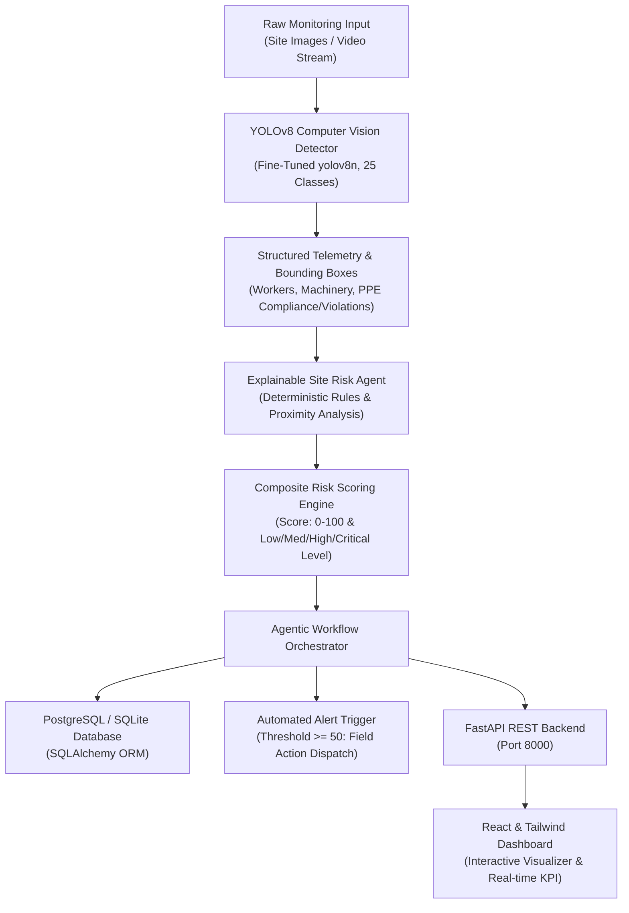

# Agentic Construction Risk Intelligence Platform

An explainable, computer-vision-powered decision-support platform designed to monitor construction sites in real time, detect personnel, machinery, and Personal Protective Equipment (PPE) compliance, evaluate safety risk rules, and present actionable intelligence on a dashboard.

---

## 🏛️ System Architecture



---

## 📊 Dataset & Verified Classes (Phase 1)

The model is trained on a verified 717-image dataset with **25 distinct classes**:

* **Personal Protective Equipment (Compliant):** `Hardhat`, `Safety Vest`, `Gloves`, `Mask`
* **Direct PPE Violations (Hazard Classes):** `NO-Hardhat`, `NO-Safety Vest`, `NO-Mask`
* **Personnel:** `Person`
* **Heavy Machinery:** `Excavator`, `wheel loader`, `dump truck`, `machinery`
* **Vehicles & Transport:** `truck`, `truck and trailer`, `trailer`, `van`, `sedan`, `SUV`, `bus`, `mini-van`, `semi`, `vehicle`
* **Hazard & Site Infrastructure:** `Safety Cone`, `Ladder`, `fire hydrant`

### Dataset Splits
* **Train:** 521 images (72.7%) &bull; 4,031 bounding boxes
* **Validation:** 114 images (15.9%) &bull; 733 bounding boxes
* **Test (Held-out):** 82 images (11.4%) &bull; 806 bounding boxes
* **Data Leakage & Corruption:** 0 duplicate hashes across splits; 0 corrupted files.

---

## 🧠 Model Training & Evaluation (Phase 2)

* **Architecture:** Ultralytics YOLOv8 Nano (`yolov8n.pt`, 3.01M parameters)
* **Weights Checkpoint:** `models/runs/yolov8n_construction_safety/weights/best.pt`
* **Training Hardware:** Intel Core i5-12450H CPU (with automatic CUDA device selector for NVIDIA GPUs).

### Performance Summary

| Metric | Validation Split | Unseen Test Split |
| :--- | :---: | :---: |
| **Precision** | **58.9%** | **68.6%** |
| **Recall** | **37.8%** | **33.9%** |
| **mAP@50** | **40.9%** | **39.5%** |
| **mAP@50-95** | **27.7%** | **27.5%** |
| **Inference Latency** | **~50.5 ms** | **~53.5 ms** (~20 FPS) |

#### Safety-Critical Detections (Test Set):
* `Excavator`: Precision **100%**, mAP@50 **77.7%**
* `Person`: Precision **84.7%**, mAP@50 **73.1%**
* `Hardhat`: Precision **87.7%**, mAP@50 **69.9%**
* `Safety Vest`: Precision **71.7%**, mAP@50 **62.7%**
* `NO-Safety Vest`: Precision **80.4%**, mAP@50 **52.9%**
* `dump truck` / `wheel loader`: Precision **75% - 88%**, mAP@50 **65% - 67%**

---

## 🛡️ Site Risk Agent & Scoring Logic (Phase 4)

The platform enforces a strict separation between **visual observation** and **inferred risk**:
1. An object is an *observed fact* (e.g. `Person`, `Excavator`).
2. A hazard is only declared if grounded in an explicit deterministic rule.

### Documented Risk Rules

| Rule ID | Name | Trigger Condition | Severity | Weight |
| :--- | :--- | :--- | :---: | :---: |
| `R01_NO_HARDHAT` | Unprotected Head | Explicit detection of `NO-Hardhat` ($\text{conf} \ge 0.30$) | HIGH | 25 |
| `R02_NO_VEST` | Low Visibility | Explicit detection of `NO-Safety Vest` ($\text{conf} \ge 0.30$) | MEDIUM | 15 |
| `R03_MACHINERY_PROXIMITY` | Machinery Proximity | Worker within operational radius ($D_{\text{norm}} \le 0.28$) of heavy equipment | HIGH | 30 |
| `R04_COMPOUND_PROXIMITY_NO_PPE` | Critical Proximity + No PPE | Worker near heavy machinery with concurrent PPE non-compliance | CRITICAL | 45 |
| `R05_LADDER_ZONE` | Elevated Fall Risk | Worker adjacent to ladder structure without confirmed tethering | MEDIUM | 15 |
| `R06_UNCONED_EQUIPMENT` | Demarcation Absence | Heavy machinery active without surrounding safety cones | LOW | 10 |

### Explainable Site Risk Formula
$$\text{Composite Score} = \min\left(100, \text{round}\left(\sum_{i \in \text{Hazards}} \text{BaseWeight}_i \times \text{Confidence}_i\right)\right)$$

* **0 – 24 (LOW):** Compliant operations or minor warnings.
* **25 – 49 (MEDIUM):** Non-critical hazards requiring supervisor attention.
* **50 – 74 (HIGH):** Field alert triggered; field intervention required.
* **75 – 100 (CRITICAL):** Immediate stop-work condition; clear personnel from equipment blind spots.

---

## 🚀 Quickstart & Execution

### 1. Run Automated Test Suite
```bash
python -m pytest tests/ -v
```
*(All 11 unit & integration tests pass verifying detection, risk math, database queries, and API routes).*

### 2. Start the Backend API & Dashboard
```bash
python -m uvicorn src.api.main:app --host 0.0.0.0 --port 8000 --reload
```

Open your browser to:
* **Interactive Dashboard:** `http://localhost:8000`
* **Interactive API Documentation (Swagger):** `http://localhost:8000/docs`

---

## 📡 REST API Reference

| Method | Endpoint | Description |
| :--- | :--- | :--- |
| `GET` | `/` | Serves the interactive React + Tailwind risk dashboard |
| `GET` | `/health` | System status, device info, and model readiness |
| `GET` | `/model/info` | Fine-tuned weights path and list of 25 supported classes |
| `POST` | `/detect/image` | Run object detection and return bounding boxes + annotated image |
| `POST` | `/detect/video` | Run video stream inference and return frame-by-frame telemetry |
| `POST` | `/risk/assess` | Complete agentic workflow: detection, risk rules, DB storage & alert |
| `GET` | `/risks` | Query historical risk assessments and hazards |
| `GET` | `/dashboard/summary` | Aggregate metrics, severity breakdown, and recent events |

---

## 🐳 Docker Deployment

To launch the complete platform with PostgreSQL using Docker Compose:

```bash
docker-compose up --build
```

---

## ⚠️ Decision-Support Disclaimer

This platform is a **decision-support prototype** driven by computer vision heuristics and statistical object detection models. It is designed to assist safety supervisors in identifying candidate hazards. It is **not** a certified life-safety system, regulatory compliance certification, or replacement for qualified safety personnel.
